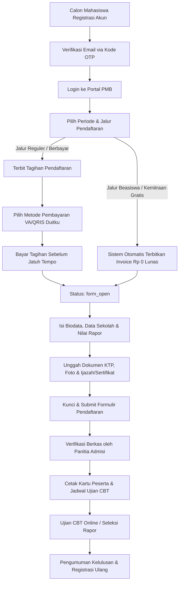

# Panduan Alur Pendaftaran Calon Mahasiswa Baru (PMB)

Dokumen ini memuat panduan lengkap alur pendaftaran bagi calon mahasiswa dan panitia admisi PMB, mencakup perbedaan alur jalur umum (berbayar) dan jalur khusus/beasiswa (gratis Rp 0) sesuai **CR-013**.

---

## 1. Diagram Alur Pendaftaran

---

## 2. Perbedaan Alur Jalur Umum vs Jalur Beasiswa (Gratis)

| Aspek | Jalur Umum / Reguler | Jalur Beasiswa / Kemitraan (Gratis) |
| :--- | :--- | :--- |
| **Biaya Formulir** | Rp 250.000 (atau sesuai skema gelombang) | **Rp 0 (Gratis)** |
| **Status Awal Formulir** | `waiting_payment` | Langsung **`form_open`** |
| **Transaksi Pembayaran** | Wajib bayar melalui Virtual Account / QRIS Duitku | Terbit invoice Rp 0 status otomatis `paid` (metode `free`) |
| **Batas Waktu Pembayaran** | 3 hari kalender (dapat diperpanjang maks 2x) | Tidak ada jatuh tempo bayar |
| **Pembatalan Mandiri** | Diizinkan selama belum membayar tagihan | Diizinkan selama status `form_open` sebelum submit berkas |
| **Dokumen Tambahan** | Dokumen identitas umum & nilai rapor | Bukti prestasi / surat rekomendasi mitra / SKTM |

---

## 3. Tata Cara Pembayaran Tagihan Jalur Umum

1. Buka menu **Pembayaran** pada dashboard calon mahasiswa.
2. Klik tombol **Bayar Sekarang**.
3. Pilih metode pembayaran:
   - **Virtual Account (BCA, Mandiri, BNI, BRI, Permata)**: Salin nomor VA dan bayar via ATM/Mobile Banking.
   - **QRIS**: Scan kode QR menggunakan aplikasi e-wallet (GoPay, OVO, Dana, ShopeePay, LinkAja) atau m-Banking.
   - **Transfer Manual**: Hanya jika pembayaran VA mengalami gangguan darurat bank.
4. Notifikasi pelunasan akan terkonfirmasi secara realtime (< 5 detik) melalui webhook resmi Duitku.
5. Unduh kuitansi resmi pelunasan di menu **Riwayat Pembayaran**.

---

## 4. Pengisian Formulir & Unggah Dokumen

1. Masuk ke halaman formulir yang berstatus `form_open`.
2. Lengkapi 4 bagian formulir:
   - **Biodata Pribadi**: NIK, Nama Lengkap, Tempat Tanggal Lahir, Jenis Kelamin, Agama, Alamat Domisili.
   - **Data Asal Sekolah**: NPSN, Nama Sekolah, Jurusan SMA/SMK, Tahun Lulus, Nilai Rata-rata Rapor.
   - **Pilihan Program Studi**: Pilihan 1 (Utama) dan Pilihan 2 (Alternatif).
   - **Data Orang Tua / Wali**: Nama Ayah/Ibu, Pekerjaan, Kontak Darurat.
3. Unggah berkas persyaratan (Format PDF/JPG/PNG, ukuran maksimal 5 MB):
   - Pindai KTP / Kartu Identitas Anak / Kartu Keluarga.
   - Pasfoto resmi berlatar belakang merah/biru.
   - Scan Ijazah / Surat Keterangan Lulus (SKL) / Rapor Semester 1–5.
   - Sertifikat prestasi (wajib untuk jalur beasiswa/prestasi).
4. Klik **Kunci & Finalisasi Formulir**. Setelah formulir dikunci, data tidak dapat diubah kembali secara mandiri.

---

## 5. Cetak Kartu Peserta Ujian & Pelaksanaan Ujian CBT

1. Setelah panitia memverifikasi dokumen (status berubah menjadi `verified`), tombol **Cetak Kartu Ujian** akan aktif.
2. Unduh berkas PDF Kartu Peserta Ujian yang memuat:
   - Nomor Pendaftaran & Nomor Peserta Ujian.
   - Program Studi Pilihan.
   - Jadwal & Sesi Ujian CBT Online.
   - Token & Tautan Masuk Ruang Ujian CBT.
3. Calon mahasiswa mengakses sistem CBT pada waktu yang telah ditentukan dan mengerjakan seluruh butir soal hingga selesai.
