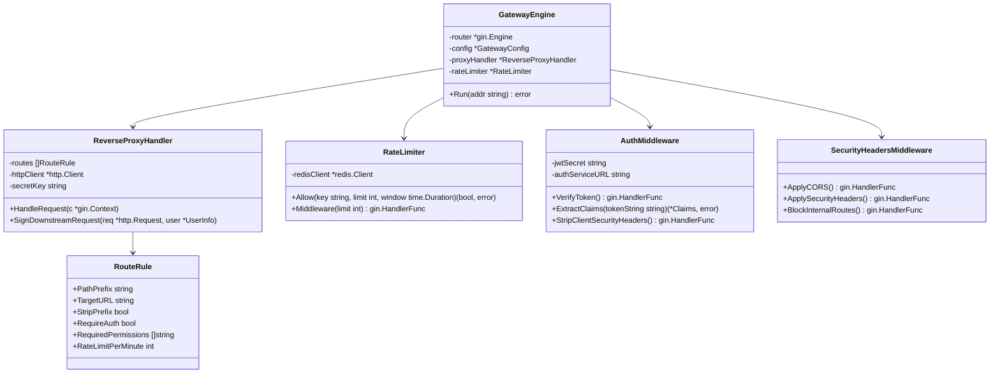

# Class Diagram — API Gateway

Diagram kelas ini menggambarkan struktur arsitektur berorientasi objek pada **API Gateway** (`services/api-gateway`), mencakup lapisan Middleware, Reverse Proxy, Route Manager, Rate Limiter, dan Security Guard.

## Deskripsi Komponen
1. **GatewayEngine**: Entry point Gin HTTP server yang memuat routing table dinamis dari `routes.yaml`.
2. **ReverseProxyHandler**: Meneruskan request client ke downstream service terkait, menambahkan signature HMAC `X-Gateway-Signature`, dan menginjeksi header identitas pengguna (`X-User-ID`, `X-User-Roles`, `X-User-Permissions`).
3. **RateLimiter**: Sliding-window rate limiting berbasis Redis untuk melindungi endpoint publik dan auth dari serangan DoS / brute force.
4. **AuthMiddleware**: Memvalidasi token JWT Bearer, memeriksa denylist token ke Redis, dan membersihkan header `X-User-*` palsu yang dikirim oleh client eksternal.
5. **SecurityHeadersMiddleware**: Memastikan endpoint `/internal/*` tidak dapat diakses langsung oleh client publik (mengembalikan 404), serta menerapkan aturan CORS dan Security Headers standar.
