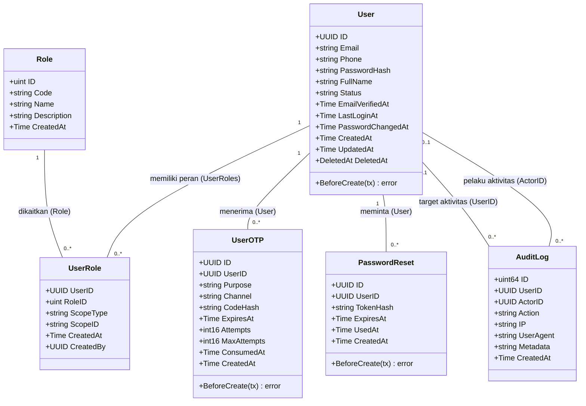
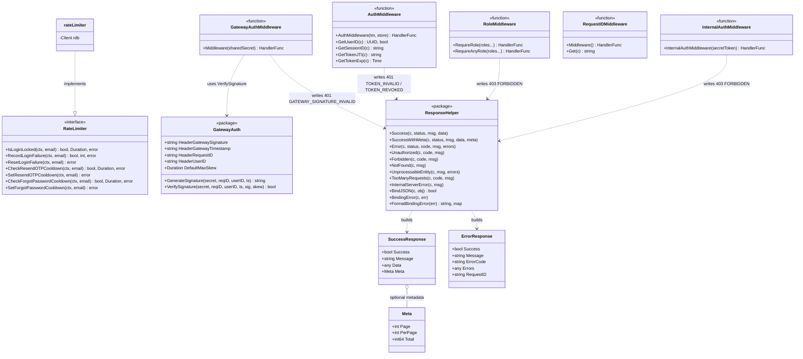

# Class Diagram Auth Service

Dokumen ini memuat representasi diagram kelas (*class diagram*) untuk layanan **Auth Service** berdasarkan kode aktual di `services/auth-service` dan modul bersama di `pkg/`. Karena bahasa Go tidak memiliki konsep *class*, diagram ini menerapkan konvensi pemetaan UML:
- **`struct`** direpresentasikan sebagai kelas (*class*).
- **`interface`** ditandai dengan stereotipe `<<interface>>`.
- **Injeksi dependensi / field struct** digambarkan sebagai asosiasi berarah (`-->`).
- **Implementasi antarmuka** digambarkan sebagai realisasi (`..|>`).

Dokumen dipecah menjadi 3 diagram modular agar mudah ditelaah dan dipahami:
1. **Domain Model** (Entitas GORM dan relasi basis data)
2. **Arsitektur Layer** (Controller → Service → Repository & Layanan Infrastruktur)
3. **Middleware & Shared Package** (Middleware keamanan, rate limiter, dan helper terpusat)

---

## 1. Domain Model

Diagram berikut menggambarkan entitas domain basis data PostgreSQL yang didefinisikan pada paket `internal/model`. Entitas utama `User` terhubung secara relasional dengan peran (`UserRole`), kode OTP verifikasi (`UserOTP`), token reset kata sandi (`PasswordReset`), dan riwayat jejak audit (`AuditLog`). Relasi ini mencerminkan struktur foreign key dan relasi ORM GORM aktual pada skema basis data PMB.

---

## 2. Arsitektur Layer

Diagram ini memetakan arsitektur berlapis *clean architecture* pada Auth Service yang terdiri atas lapisan Controller (HTTP transport Gin), Lapisan Business Logic (Service), dan Lapisan Data Access (Repository). Setiap service dan repository diikat oleh antarmuka (*interface*) untuk memfasilitasi *dependency injection*, *inversion of control*, dan kemudahan pengujian unit (*mocking*). Selain itu, diagram mencakup komponen utilitas penting seperti penerbitan token JWT RS256 (`TokenManager`), penyimpanan sesi Redis (`SessionStore`), serta pengiriman surel (`Mailer`).

```mermaid
classDiagram
    direction TB

    %% Presentation Layer / Controllers
    class AuthController {
        -AuthService authService
        -TokenManager tokenManager
        +Register(c)
        +VerifyOTP(c)
        +ResendOTP(c)
        +Login(c)
        +Refresh(c)
        +GetMe(c)
        +UpdateProfile(c)
        +ChangePassword(c)
        +ForgotPassword(c)
        +ResetPassword(c)
        +Logout(c)
        +LogoutAll(c)
        +GetJWKS(c)
    }

    class AdminController {
        -AdminService adminService
        +GetRoles(c)
        +ListUsers(c)
        +CreateUser(c)
        +GetUser(c)
        +UpdateUser(c)
        +UpdateUserRoles(c)
        +UpdateUserStatus(c)
    }

    class InternalController {
        -AdminService adminService
        +GetUser(c)
        +GetBatchUsers(c)
        +AddUserRole(c)
    }

    class HealthController {
        -DB db
        -Client rdb
        -string env
        +LivenessCheck(c)
        +HealthCheck(c)
    }

    %% Business Logic Layer / Services
    class AuthService {
        <<interface>>
        +Register(ctx, req) RegisterResponse
        +VerifyOTP(ctx, req, ip, ua) AuthResponseData
        +ResendOTP(ctx, req) error
        +Login(ctx, req, ip, ua) AuthResponseData
        +Refresh(ctx, req) AuthResponseData
        +Logout(ctx, userID, sessionID, jti, exp) error
        +LogoutAll(ctx, userID, jti, exp) error
        +GetMe(ctx, userID) UserResponseData
        +UpdateProfile(ctx, userID, req) UserResponseData
        +ChangePassword(ctx, userID, req) error
        +ForgotPassword(ctx, req) error
        +ResetPassword(ctx, req) error
    }

    class authService {
        -Config cfg
        -UserRepository userRepo
        -RoleRepository roleRepo
        -OTPRepository otpRepo
        -PasswordResetRepository resetRepo
        -AuditLogRepository auditRepo
        -TokenManager tokenManager
        -SessionStore sessionStore
        -RateLimiter rateLimiter
        -Mailer mailer
        -Logger log
    }

    class AdminService {
        <<interface>>
        +GetRoles(ctx) RoleResponseData[]
        +ListUsers(ctx, query) UserResponseData[], int64
        +CreateUser(ctx, req, actorID) UserResponseData
        +GetUser(ctx, id) UserResponseData
        +UpdateUser(ctx, id, req, actorID) UserResponseData
        +UpdateUserRoles(ctx, id, req, actorID) UserResponseData
        +UpdateUserStatus(ctx, id, req, actorID) UserResponseData
        +InternalGetUser(ctx, id) UserResponseData
        +InternalGetUsersBatch(ctx, ids) UserResponseData[]
        +InternalAddRole(ctx, id, req) UserResponseData
    }

    class adminService {
        -Config cfg
        -UserRepository userRepo
        -RoleRepository roleRepo
        -PasswordResetRepository resetRepo
        -AuditLogRepository auditRepo
        -SessionStore sessionStore
        -Mailer mailer
        -Logger logger
    }

    %% Security & Utility Services
    class TokenManager {
        <<interface>>
        +GenerateAccessToken(userID, email, name, roles, scopes, sessionID) tokenStr, jti, exp, error
        +GenerateRefreshToken(userID, sessionID) tokenStr, jti, exp, error
        +ValidateAccessToken(tokenStr) AccessClaims, error
        +ValidateRefreshToken(tokenStr) RefreshClaims, error
        +GetJWKS() JWKSResponse
        +PublicKey() PublicKey
    }

    class tokenManager {
        -Config cfg
        -PrivateKey privateKey
        -PublicKey publicKey
        -Logger log
    }

    class SessionStore {
        <<interface>>
        +SaveSession(ctx, userID, sessionID, jti, ttl) error
        +ValidateSession(ctx, userID, sessionID, jti) valid, reuseDetected, error
        +RotateSession(ctx, userID, sessionID, newJTI, ttl) error
        +RevokeSession(ctx, userID, sessionID) error
        +RevokeAllUserSessions(ctx, userID) error
        +AddToDenylist(ctx, jti, ttl) error
        +IsDenylisted(ctx, jti) bool, error
    }

    class sessionStore {
        -Client rdb
    }

    class Mailer {
        <<interface>>
        +SendOTP(ctx, toEmail, toName, otpCode) error
        +SendPasswordReset(ctx, toEmail, toName, resetLink) error
    }

    class logMailer {
        -string appName
        -Logger log
    }

    class smtpMailer {
        -Config cfg
        -Logger log
    }

    %% Data Access Layer / Repositories
    class UserRepository {
        <<interface>>
        +Create(ctx, user) error
        +FindByID(ctx, id) User, error
        +FindByEmail(ctx, email) User, error
        +Update(ctx, user) error
        +UpdatePassword(ctx, userID, passwordHash) error
        +UpdateLastLogin(ctx, userID) error
        +UpdateStatus(ctx, userID, status) error
        +ExistsByEmail(ctx, email) bool, error
        +FindUsers(ctx, role, status, q, page, perPage) User[], int64, error
        +FindBatch(ctx, ids) User[], error
    }

    class userRepository {
        -DB db
    }

    class RoleRepository {
        <<interface>>
        +FindByCode(ctx, code) Role, error
        +FindAll(ctx) Role[], error
        +AssignRole(ctx, userRole) error
        +GetUserRoles(ctx, userID) UserRole[], error
        +RemoveUserRoles(ctx, userID) error
        +ReplaceUserRoles(ctx, userID, roles) error
        +CountActiveSuperadmins(ctx) int64, error
    }

    class roleRepository {
        -DB db
    }

    class OTPRepository {
        <<interface>>
        +Create(ctx, otp) error
        +FindLatestActive(ctx, userID, purpose) UserOTP, error
        +IncrementAttempts(ctx, otpID) int16, error
        +MarkConsumed(ctx, otpID) error
        +InvalidateActiveOTPs(ctx, userID, purpose) error
    }

    class otpRepository {
        -DB db
    }

    class PasswordResetRepository {
        <<interface>>
        +Create(ctx, reset) error
        +FindByTokenHash(ctx, tokenHash) PasswordReset, error
        +MarkUsed(ctx, resetID) error
        +InvalidateActiveTokens(ctx, userID) error
    }

    class passwordResetRepository {
        -DB db
    }

    class AuditLogRepository {
        <<interface>>
        +Create(ctx, log) error
    }

    class auditLogRepository {
        -DB db
    }

    %% Relationships - Controllers to Services
    AuthController --> AuthService : uses
    AuthController --> TokenManager : uses
    AdminController --> AdminService : uses
    InternalController --> AdminService : uses

    %% Realizations - Services
    authService ..|> AuthService : implements
    adminService ..|> AdminService : implements

    %% Dependencies - Services to Repositories & Utilities
    authService --> UserRepository : userRepo
    authService --> RoleRepository : roleRepo
    authService --> OTPRepository : otpRepo
    authService --> PasswordResetRepository : resetRepo
    authService --> AuditLogRepository : auditRepo
    authService --> TokenManager : tokenManager
    authService --> SessionStore : sessionStore
    authService --> Mailer : mailer

    adminService --> UserRepository : userRepo
    adminService --> RoleRepository : roleRepo
    adminService --> PasswordResetRepository : resetRepo
    adminService --> AuditLogRepository : auditRepo
    adminService --> SessionStore : sessionStore
    adminService --> Mailer : mailer

    %% Realizations - Repositories & Utilities
    userRepository ..|> UserRepository : implements
    roleRepository ..|> RoleRepository : implements
    otpRepository ..|> OTPRepository : implements
    passwordResetRepository ..|> PasswordResetRepository : implements
    auditLogRepository ..|> AuditLogRepository : implements
    tokenManager ..|> TokenManager : implements
    sessionStore ..|> SessionStore : implements
    logMailer ..|> Mailer : implements
    smtpMailer ..|> Mailer : implements
```

---

## 3. Middleware & Shared Packages

Diagram berikut memperlihatkan komponen filter HTTP (*middleware*) serta pustaka terpusat (*shared packages*) yang melindungi rute Auth Service. Komponen mencakup verifikasi HMAC gateway signature (`pkg/gatewayauth`), autentikasi bearer token JWT dan pencegahan penggunaan token tercabut (`middleware.AuthMiddleware`), proteksi RBAC (`middleware.RequireRole`), token antar-layanan (`middleware.InternalAuthMiddleware`), serta pelacak request ID (`pkg/requestid`) dan pembangun format respons/validasi terstandarisasi (`pkg/response`).

