# Class Diagram — Identity Service

Diagram kelas UML berikut menggambarkan arsitektur aktual dari **Identity Service** (`services/identity-service`), mencakup domain model, repository, service (kriptografi AES-GCM, masking NIK, kelengkapan biodata, dan pemindaian OCR KTP), controller, dan router.

```mermaid
classDiagram
    direction TB

    %% Model Entitas
    class Person {
        +UUID UserID
        +string FullName
        +string NIK
        +string NIKHash
        +string BirthPlace
        +Time BirthDate
        +string Gender
        +string Religion
        +string Nationality
        +string Phone
        +string PhotoObjectKey
        +Time CreatedAt
        +Time UpdatedAt
    }

    class Address {
        +UUID ID
        +UUID UserID
        +string Type
        +string Street
        +string RT
        +string RW
        +string Village
        +string District
        +string City
        +string Province
        +string PostalCode
    }

    class Guardian {
        +UUID ID
        +UUID UserID
        +string Relation
        +string Name
        +string Occupation
        +string IncomeRange
        +string Phone
    }

    class EducationHistory {
        +UUID ID
        +UUID UserID
        +string Level
        +string SchoolName
        +string NPSN
        +string Major
        +int GraduationYear
    }

    class KTPScan {
        +UUID ID
        +UUID UserID
        +string ObjectKey
        +string JobID
        +string Status
        +float64 QualityScore
        +bool Enhanced
        +string Reason
        +string ReasonMessage
        +string FieldConfidences
        +string OCRDataRaw
        +Time ConfirmedAt
        +string FieldsEditedByUser
    }

    Person "1" o-- "0..*" Address : memiliki
    Person "1" o-- "0..*" Guardian : memiliki
    Person "1" o-- "0..*" EducationHistory : memiliki
    Person "1" o-- "0..*" KTPScan : melakukan

    %% Repositories
    class PersonRepository {
        <<interface>>
        +FindByUserID(ctx, userID) (*Person, error)
        +FindByNIKHash(ctx, nikHash) (*Person, error)
        +Save(ctx, person) error
        +UpdatePhoto(ctx, userID, photoKey) error
        +GetDetailWithRelations(ctx, userID) (*Person, error)
        +FindByUserIDs(ctx, userIDs) ([]Person, error)
    }

    class AddressRepository {
        <<interface>>
        +FindByUserID(ctx, userID) ([]Address, error)
        +FindByUserIDAndType(ctx, userID, type) (*Address, error)
        +Save(ctx, address) error
    }

    class GuardianRepository {
        <<interface>>
        +FindByUserID(ctx, userID) ([]Guardian, error)
        +FindByUserIDAndRelation(ctx, userID, relation) (*Guardian, error)
        +Save(ctx, guardian) error
    }

    class EducationRepository {
        <<interface>>
        +FindByUserID(ctx, userID) ([]EducationHistory, error)
        +Save(ctx, edu) error
        +DeleteByUserID(ctx, userID) error
    }

    class KTPScanRepository {
        <<interface>>
        +Create(ctx, scan) error
        +FindByID(ctx, id) (*KTPScan, error)
        +FindByUserID(ctx, userID) ([]KTPScan, error)
        +Update(ctx, scan) error
        +CountScansSince(ctx, userID, since) (int64, error)
    }

    %% Crypto Package
    class CryptoModule {
        +DeriveKey(secret) []byte
        +HashNIK(plainNIK) string
        +EncryptNIK(plainNIK, key) (string, error)
        +DecryptNIK(encryptedNIK, key) (string, error)
        +MaskNIK(nik) string
    }

    %% Services
    class IdentityService {
        <<interface>>
        +GetProfile(ctx, targetUserID, callerUserID, callerRoles) (*ProfileResponse, error)
        +UpdateProfile(ctx, userID, req) (*ProfileResponse, error)
        +GetAddresses(ctx, userID) ([]AddressResponse, error)
        +SaveAddress(ctx, userID, req) (*AddressResponse, error)
        +GetGuardians(ctx, userID) ([]GuardianResponse, error)
        +SaveGuardian(ctx, userID, req) (*GuardianResponse, error)
        +GetEducation(ctx, userID) ([]EducationHistoryResponse, error)
        +SaveEducation(ctx, userID, req) (*EducationHistoryResponse, error)
        +UpdatePhoto(ctx, userID, reader, size, contentType) (string, error)
        +GetPersonDetail(ctx, targetUserID, callerUserID, callerRoles) (*PersonDetailResponse, error)
        +BatchGetPersons(ctx, userIDs) ([]PersonDetailResponse, error)
    }

    class CompletenessService {
        <<interface>>
        +CheckCompleteness(ctx, userID) (*CompletenessResponse, error)
    }

    class KTPScanService {
        <<interface>>
        +InitiateKTPScan(ctx, userID, reader, size, filename, contentType) (*KTPScanInitiateResponse, error)
        +GetKTPScanStatus(ctx, scanID, userID) (*KTPScanStatusResponse, error)
        +ConfirmKTPScan(ctx, scanID, userID, req) (*ProfileResponse, error)
    }

    IdentityService ..> CryptoModule : menggunakan
    IdentityService --> PersonRepository
    IdentityService --> AddressRepository
    IdentityService --> GuardianRepository
    IdentityService --> EducationRepository
    CompletenessService --> PersonRepository
    KTPScanService --> KTPScanRepository
    KTPScanService --> IdentityService

    %% Controllers
    class UserController {
        +GetMyProfile(c)
        +UpdateMyProfile(c)
        +GetMyAddresses(c)
        +SaveMyAddress(c)
        +GetMyGuardians(c)
        +SaveMyGuardian(c)
        +GetMyEducation(c)
        +SaveMyEducation(c)
        +UpdateMyPhoto(c)
        +GetMyCompleteness(c)
        +InitiateKTPScan(c)
        +GetKTPScanStatus(c)
        +ConfirmKTPScan(c)
    }

    class AdminController {
        +GetPersonDetail(c)
    }

    class InternalController {
        +GetPersonByID(c)
        +GetPersonCompleteness(c)
        +BatchGetPersons(c)
    }

    class HealthController {
        +Liveness(c)
        +Readiness(c)
    }

    UserController --> IdentityService
    UserController --> CompletenessService
    UserController --> KTPScanService
    AdminController --> IdentityService
    AdminController --> CompletenessService
    InternalController --> IdentityService
    InternalController --> CompletenessService
```

