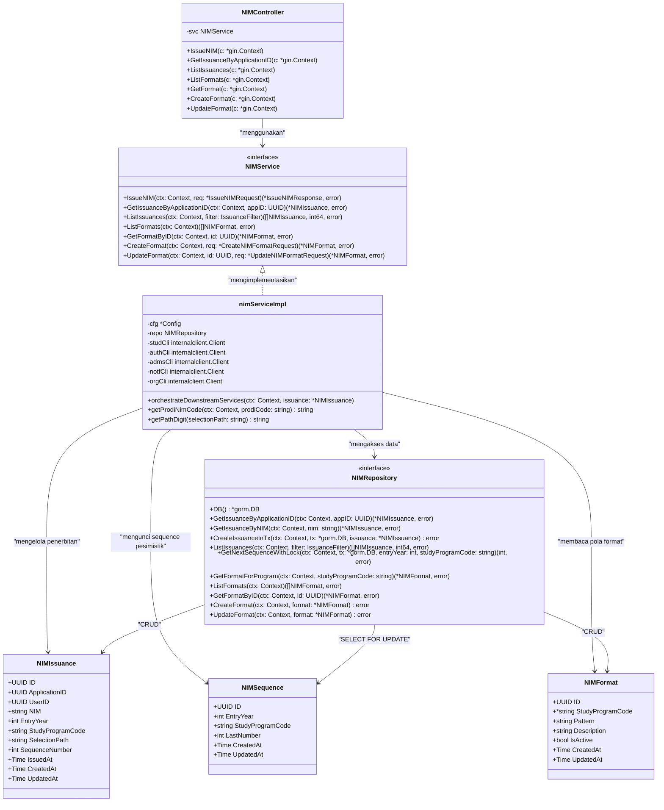

# Class Diagram — NIM Service

Diagram kelas ini menggambarkan struktur arsitektur berorientasi objek pada **NIM Service** (`services/nim-service`), mencakup lapisan Controller, Domain Service, Repositori Data, Inter-Service Client, dan Entitas Model.

