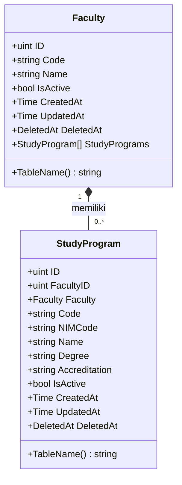
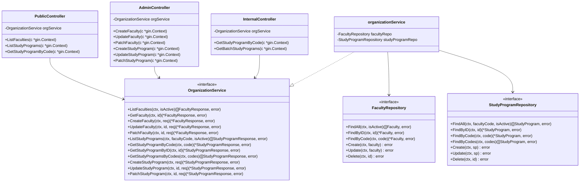
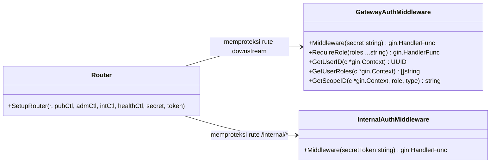

# Class Diagram Organization Service

Dokumen ini memuat representasi diagram kelas (*class diagram*) untuk layanan **Organization Service** berdasarkan kode aktual di `services/organization-service` dan modul bersama di `pkg/`.

---

## 1. Domain Model

Diagram entitas basis data PostgreSQL pada paket `internal/model`. Relasi satu fakultas memiliki banyak program studi (*one-to-many*).

---

## 2. Arsitektur Layer (Controller, Service, Repository)

Diagram berikut menggambarkan alur dependensi Controller $\rightarrow$ Service $\rightarrow$ Repository.

---

## 3. Middleware & Keamanan Inter-Service

