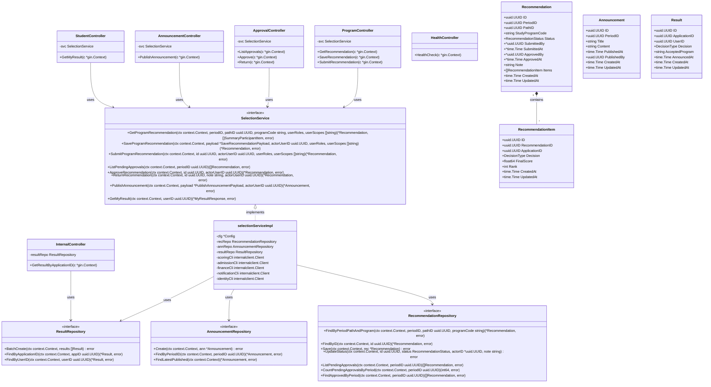

# Class Diagram — Selection Service (F2-M9)

Dokumen ini memuat arsitektur kelas, antarmuka, model, repository, service layer, dan controller untuk **Selection Service** (`services/selection-service`).

