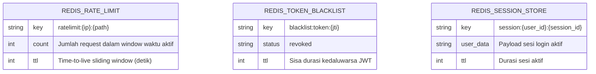
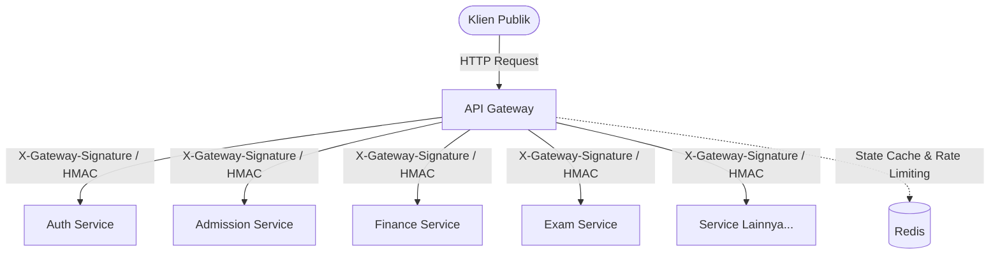

# Entity-Relationship Diagram (ERD) — API Gateway

Layanan **API Gateway** (`services/api-gateway`) didesain sebagai **stateless reverse proxy**, sehingga tidak memiliki tabel basis data relasional (PostgreSQL) tersendiri. Seluruh data autentikasi dan otorisasi dikelola oleh `auth-service`, sementara status sesi sementara disimpan di cache Redis.

## Penyimpanan State Sementara (Redis Cache & Rate Limiting)

## Relasi Logis dengan Downstream Services

API Gateway bertindak sebagai pintu gerbang tunggal (*Single Entry Point*) yang menghubungkan klien eksternal (Browser, Mobile App, Postman) ke service hilir melalui penandatanganan request HMAC:

