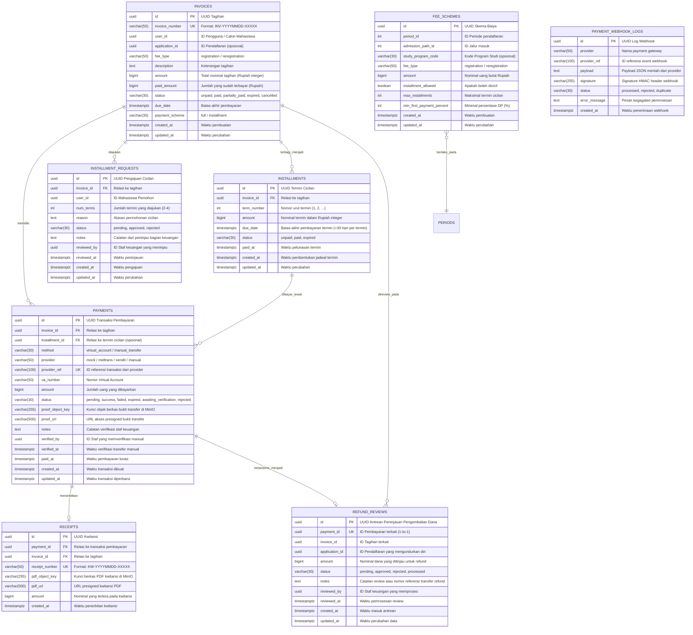

# Entity Relationship Diagram (ERD) — Finance Service

Dokumen ini memetakan relasi tabel-tabel pada basis data `pmb_finance`.

## Penjelasan Tabel & Integritas Data (CR-007)

1. **`refund_reviews`**:
   - Dibuat secara otomatis ketika suatu pendaftaran mahasiswa disetujui pengunduran dirinya (`withdrawn`) melalui Admission Service.
   - Seluruh transaksi pembayaran yang berstatus lunas (`success`) pada pendaftaran tersebut akan didaftarkan ke tabel `refund_reviews` dengan status awal `pending`.
   - Staf keuangan dapat meninjau, menyetujui, mencairkan, atau menolak pengembalian dana melalui antarmuka Finance Service.
   - Kolom `payment_id` bersifat unik (`UNIQUE`) guna mencegah pendaftaran duplikat untuk transaksi pembayaran yang sama.

