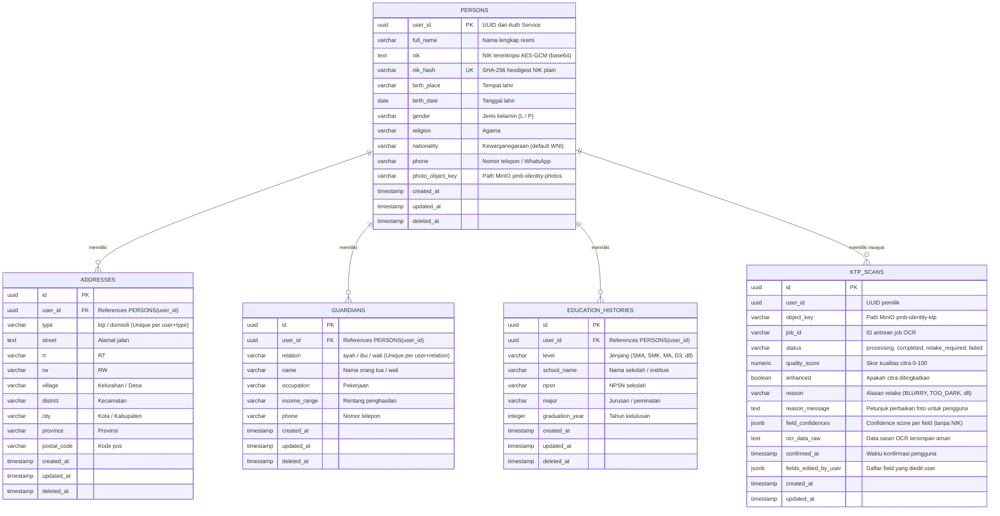

# Entity Relationship Diagram (ERD) — Database `pmb_identity`

Diagram ERD berikut menggambarkan skema relasi tabel pada basis data `pmb_identity` yang dikelola secara eksklusif oleh **Identity Service**.

