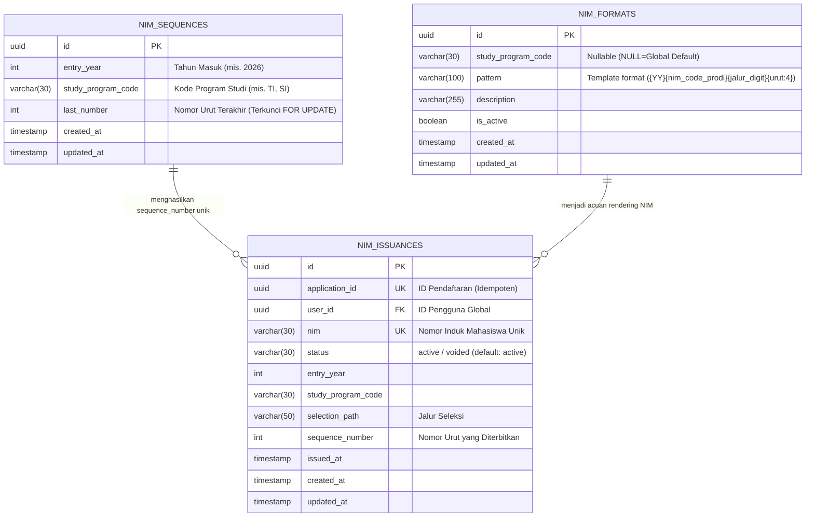

# Entity Relationship Diagram (ERD) — NIM Service

Dokumen ini mendeskripsikan skema relasi basis data pada **NIM Service** (`pmb_nim`). Layanan ini mengelola template format penomoran NIM, pencatatan sequence counter berbasis penguncian pesimistik (`SELECT ... FOR UPDATE`), dan riwayat resmi penerbitan NIM (*idempotent issuance*).

## Penjelasan Tabel & Integritas Data

1. **`nim_formats`**:
   - Menyimpan konfigurasi pola NIM yang dapat diubah oleh peran `superadmin`.
   - Pola default `{YY}{nim_code_prodi}{jalur_digit}{urut:4}`:
     - `{YY}`: 2 digit tahun pendaftaran (contoh: 2026 -> `26`).
     - `{nim_code_prodi}`: 2 digit kode NIM program studi dari Organization Service (contoh: TI -> `55`, SI -> `57`).
     - `{jalur_digit}`: 1 digit representasi jalur masuk (1=reguler, 2=prestasi, 3=beasiswa, 4=pindahan).
     - `{urut:4}`: 4 digit nomor urut pendaftaran dengan padding nol (contoh: `0001`, `0042`).

2. **`nim_sequences`**:
   - Memiliki *unique constraint* kombinasi `(entry_year, study_program_code)`.
   - Baris di-lock secara atomik menggunakan query pesimistik `SELECT ... FOR UPDATE` dalam transaksi database PostgreSQL saat penerbitan, sehingga menjamin tidak ada duplikasi nomor urut walaupun terjadi puluhan permintaan penerbitan bersamaan.
   - Sesuai Keputusan P4 (CR-007), sequence counter tidak pernah dimundurkan jika ada pembatalan NIM, agar nomor urut tetap unik dan audit trail terjaga.

3. **`nim_issuances`**:
   - Kolom `application_id` berstatus `UNIQUE`. Jika layanan dipanggil berulang kali untuk ID pendaftaran yang sama, sistem langsung mengembalikan rekor NIM yang telah ada (*idempotent*) tanpa menaikkan sequence counter.
   - Kolom `nim` berstatus `UNIQUE` di tingkat basis data.
   - Kolom `status`:
     - `active`: NIM resmi aktif digunakan oleh mahasiswa.
     - `voided`: NIM dibatalkan statusnya akibat mahasiswa mengundurkan diri (CR-007). Rekor dan nomor NIM tidak dihapus dari basis data demi integritas audit dan sejarah akademik.

