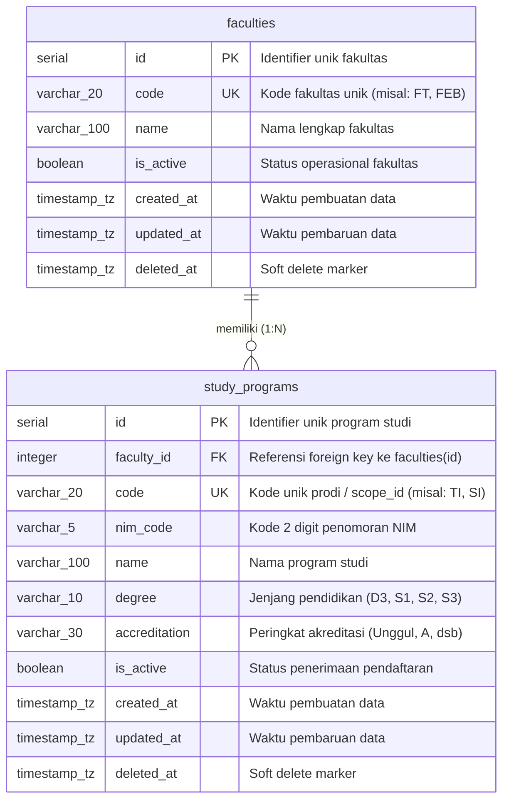

# Entity Relationship Diagram (ERD) — Organization Service

Dokumen ini memuat ERD (*Entity Relationship Diagram*) untuk skema basis data PostgreSQL **`pmb_organization`** pada **Organization Service**.

---

## 1. Diagram ERD (Mermaid)

---

## 2. Indeks & Batasan Basis Data

| Tabel | Nama Indeks | Kolom | Tipe | Keterangan |
|---|---|---|---|---|
| `faculties` | `faculties_pkey` | `id` | PRIMARY KEY | Identitas unik |
| `faculties` | `faculties_code_key` | `code` | UNIQUE | Mencegah duplikasi kode fakultas |
| `faculties` | `idx_faculties_deleted_at` | `deleted_at` | B-TREE | Optimasi soft delete query |
| `study_programs` | `study_programs_pkey` | `id` | PRIMARY KEY | Identitas unik |
| `study_programs` | `study_programs_code_key` | `code` | UNIQUE | Digunakan sebagai `scope_id` di Auth |
| `study_programs` | `idx_study_programs_faculty_id` | `faculty_id` | B-TREE | Optimasi relasi join fakultas |
| `study_programs` | `idx_study_programs_code` | `code` | B-TREE | Optimasi query pencarian kode prodi |
| `study_programs` | `idx_study_programs_deleted_at` | `deleted_at` | B-TREE | Optimasi soft delete query |
