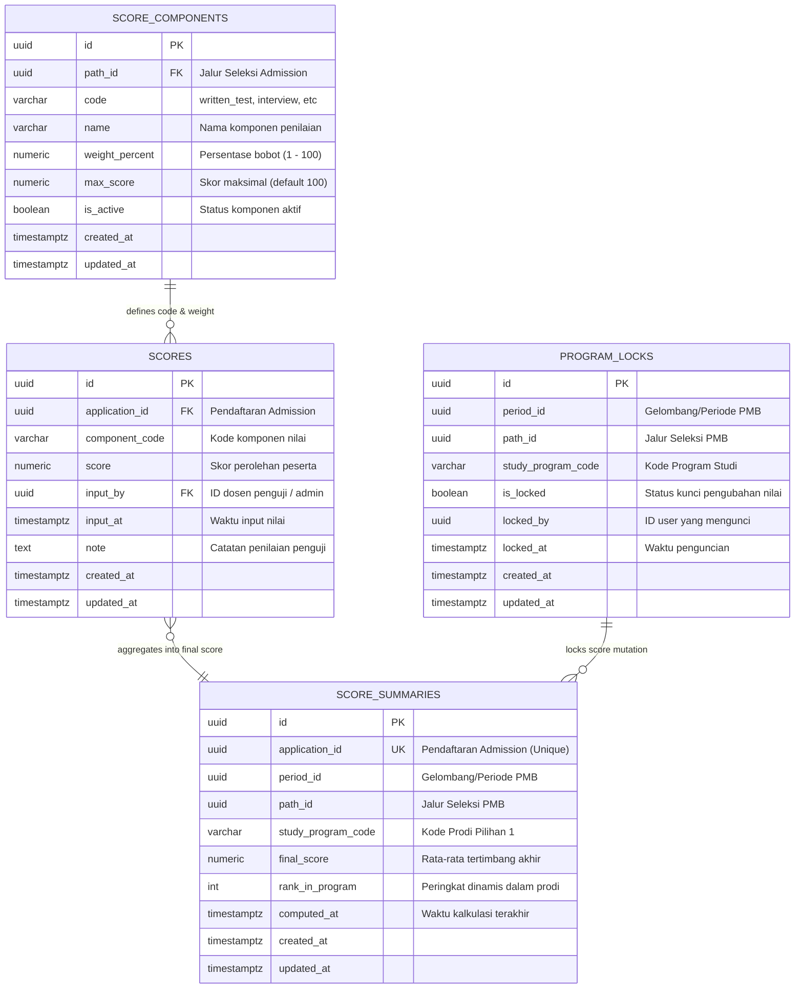

# Entity Relationship Diagram — Scoring Service (pmb_scoring)

Dokumen ini mendokumentasikan skema relasional tabel pada basis data `pmb_scoring`.

### Penjelasan Kunci & Aturan Bisnis
1. **Total Bobot Wajib 100%**: $\sum \text{weight\_percent} = 100.00$ untuk seluruh komponen aktif pada suatu `path_id`.
2. **Keunikan Nilai Peserta**: `UNIQUE(application_id, component_code)` memastikan satu komponen nilai hanya memiliki 1 catatan per peserta.
3. **Penguncian Nilai**: `UNIQUE(period_id, path_id, study_program_code)` pada `program_locks` melindungi seluruh perubahan nilai setelah tahap evaluasi rekomendasi dimulai.
