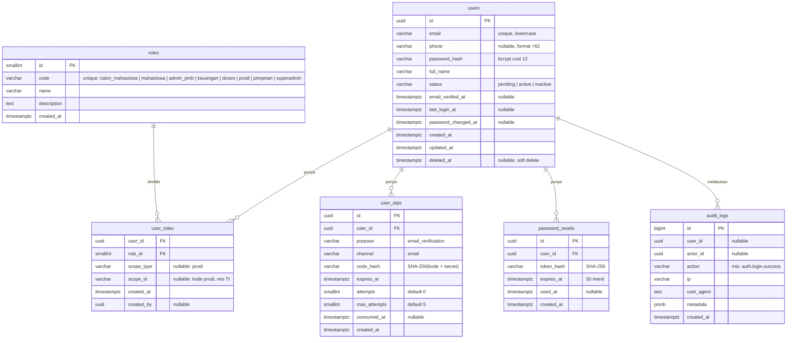
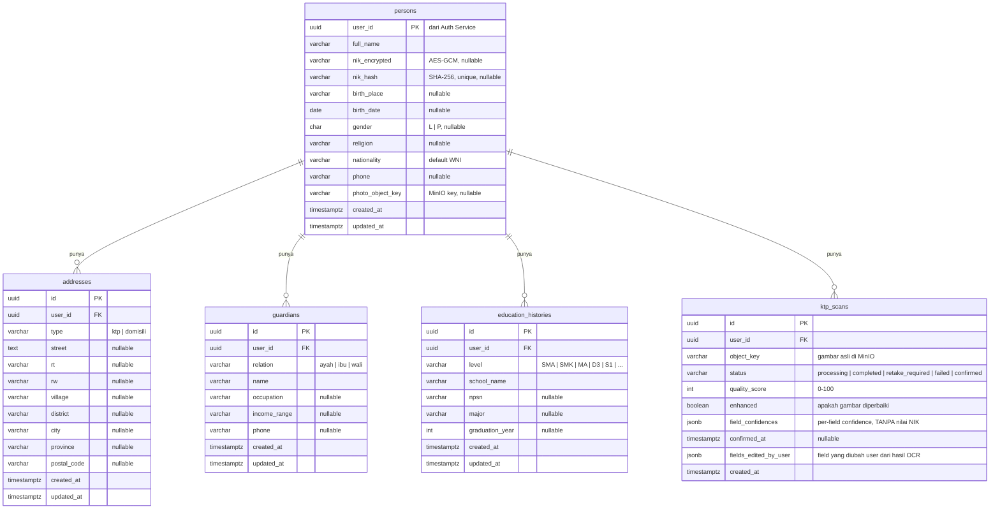
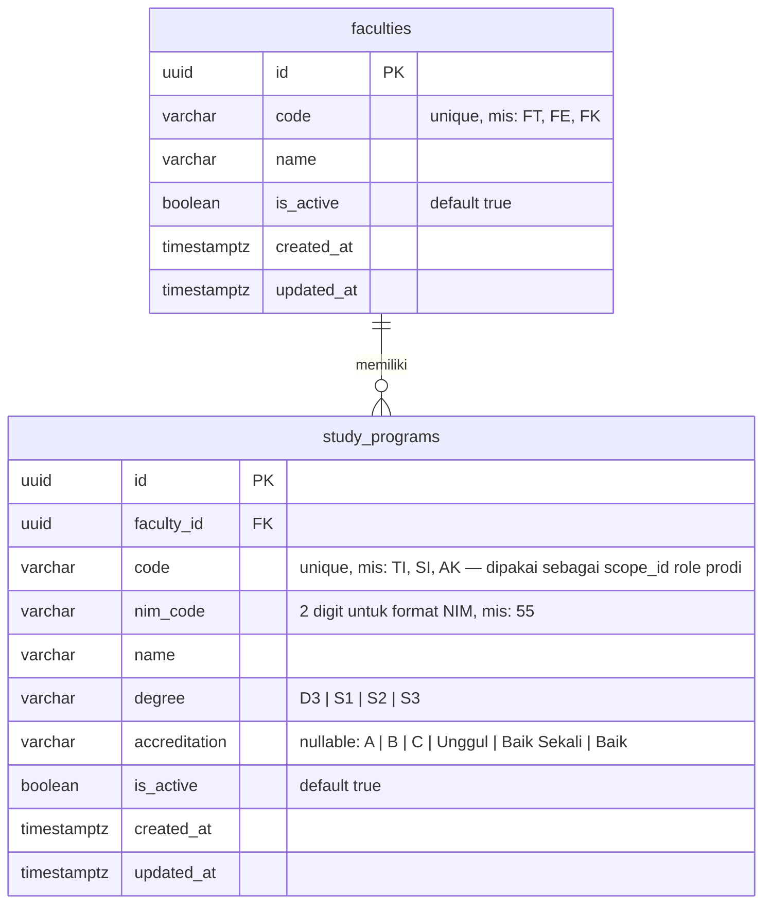
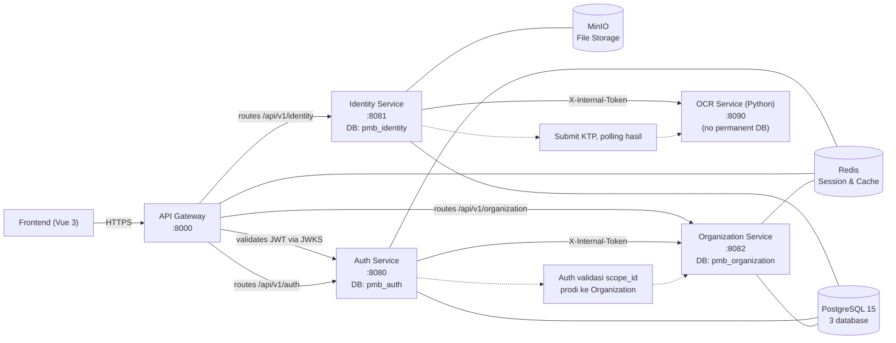

# Schema Database & Class Diagram
# Auth Service · Identity Service · Organization Service
# Draft v1 — 22 September 2026
# Format: Mermaid (render otomatis di GitHub dan draw.io → Extras → Edit Diagram)

---

## Daftar Isi
1. [Auth Service — Schema Database (ERD)](#1-auth-service--schema-database)
2. [Auth Service — Class Diagram](#2-auth-service--class-diagram)
3. [Identity Service — Schema Database (ERD)](#3-identity-service--schema-database)
4. [Identity Service — Class Diagram](#4-identity-service--class-diagram)
5. [Organization Service — Schema Database (ERD)](#5-organization-service--schema-database)
6. [Organization Service — Class Diagram](#6-organization-service--class-diagram)
7. [Hubungan Antar Service](#7-hubungan-antar-service)

---

## 1. Auth Service — Schema Database

**Database:** `pmb_auth`
Semua primary key UUID kecuali `roles` (smallserial). Soft delete pada `users` (`deleted_at`).

**Catatan:**
- `user_roles` unique constraint: `(user_id, role_id, scope_type, scope_id)`
- `code_hash` di `user_otps`: bukan plaintext, bukan hash sederhana — SHA-256 dari `kode + OTP_SECRET`
- `audit_logs` tidak memakai soft delete; data audit tidak boleh dihapus

---

## 2. Auth Service — Class Diagram

**Pola arsitektur:** Handler → Service (interface) → Repository (interface) → DB/Redis

```mermaid
classDiagram
    direction TB

    %% ── HANDLER / CONTROLLER ──
    class AuthHandler {
        +Register(c *gin.Context)
        +VerifyOTP(c *gin.Context)
        +ResendOTP(c *gin.Context)
        +Login(c *gin.Context)
        +Refresh(c *gin.Context)
        +ForgotPassword(c *gin.Context)
        +ResetPassword(c *gin.Context)
        +Me(c *gin.Context)
        +UpdateProfile(c *gin.Context)
        +ChangePassword(c *gin.Context)
        +Logout(c *gin.Context)
        +LogoutAll(c *gin.Context)
    }

    class AdminHandler {
        +ListRoles(c *gin.Context)
        +ListUsers(c *gin.Context)
        +CreateUser(c *gin.Context)
        +GetUser(c *gin.Context)
        +UpdateUser(c *gin.Context)
        +UpdateUserRoles(c *gin.Context)
        +UpdateUserStatus(c *gin.Context)
    }

    class InternalHandler {
        +GetUser(c *gin.Context)
        +BatchGetUsers(c *gin.Context)
        +AddUserRole(c *gin.Context)
    }

    class JWKSHandler {
        +ServeJWKS(c *gin.Context)
    }

    %% ── SERVICE ──
    class AuthService {
        <<interface>>
        +Register(ctx, req) (*TokenPair, error)
        +VerifyOTP(ctx, req) (*TokenPair, error)
        +ResendOTP(ctx, email) error
        +Login(ctx, req) (*TokenPair, error)
        +Refresh(ctx, refreshToken) (*TokenPair, error)
        +ForgotPassword(ctx, email) error
        +ResetPassword(ctx, req) error
        +Logout(ctx, userID, sid, jti, exp) error
        +LogoutAll(ctx, userID) error
        +GetProfile(ctx, userID) (*UserProfile, error)
        +UpdateProfile(ctx, userID, req) error
        +ChangePassword(ctx, userID, req) error
    }

    class AuthServiceImpl {
        -userRepo UserRepository
        -roleRepo RoleRepository
        -otpRepo  OTPRepository
        -pwdRepo  PasswordResetRepository
        -auditRepo AuditLogRepository
        -tokenMgr TokenManager
        -session  SessionStore
        -mailer   Mailer
    }

    class AdminService {
        <<interface>>
        +ListRoles(ctx) ([]Role, error)
        +ListUsers(ctx, filter) (*PaginatedUsers, error)
        +CreateUser(ctx, req) (*User, error)
        +UpdateUserRoles(ctx, userID, roles) error
        +UpdateUserStatus(ctx, userID, status) error
    }

    %% ── REPOSITORY ──
    class UserRepository {
        <<interface>>
        +Create(ctx, user) error
        +FindByEmail(ctx, email) (*User, error)
        +FindByID(ctx, id) (*User, error)
        +Update(ctx, user) error
        +FindWithRoles(ctx, id) (*User, error)
    }

    class RoleRepository {
        <<interface>>
        +FindAll(ctx) ([]Role, error)
        +FindByCode(ctx, code) (*Role, error)
        +SetUserRoles(ctx, userID, roles) error
    }

    class OTPRepository {
        <<interface>>
        +Create(ctx, otp) error
        +FindActive(ctx, userID, purpose) (*UserOTP, error)
        +MarkConsumed(ctx, id) error
        +IncrementAttempts(ctx, id) error
    }

    class PasswordResetRepository {
        <<interface>>
        +Create(ctx, pr) error
        +FindByTokenHash(ctx, hash) (*PasswordReset, error)
        +MarkUsed(ctx, id) error
    }

    class AuditLogRepository {
        <<interface>>
        +Create(ctx, log) error
    }

    %% ── TOKEN & SESSION ──
    class TokenManager {
        <<interface>>
        +GenerateTokenPair(ctx, user, roles, scopes) (*TokenPair, error)
        +ValidateAccessToken(tokenStr) (*Claims, error)
        +ValidateRefreshToken(tokenStr) (*RefreshClaims, error)
        +GetJWKS() *jose.JSONWebKeySet
    }

    class RSATokenManager {
        -privateKey *rsa.PrivateKey
        -publicKey  *rsa.PublicKey
        -kid        string
        -accessTTL  time.Duration
        -refreshTTL time.Duration
    }

    class SessionStore {
        <<interface>>
        +SaveRefresh(ctx, sub, sid, jti, ttl) error
        +ValidateRefresh(ctx, sub, sid, jti) (bool, error)
        +RotateRefresh(ctx, sub, sid, newJTI, ttl) error
        +DeleteSession(ctx, sub, sid) error
        +DeleteAllSessions(ctx, sub) error
        +AddToDenylist(ctx, jti, ttl) error
        +IsRevoked(ctx, jti) (bool, error)
    }

    class RedisSessionStore {
        -client *redis.Client
    }

    %% ── MAILER ──
    class Mailer {
        <<interface>>
        +SendOTP(ctx, to, name, otp string) error
        +SendPasswordReset(ctx, to, name, link string) error
    }

    class SMTPMailer {
        -host, port, user, pass string
        -fromAddr, fromName string
    }

    class LogMailer {
        -logger *zap.Logger
    }

    %% ── MIDDLEWARE ──
    class JWTMiddleware {
        +Handle() gin.HandlerFunc
        -validateToken(tokenStr) (*Claims, error)
        -checkDenylist(jti) bool
    }

    class GatewayAuthMiddleware {
        +Handle() gin.HandlerFunc
        -verifyHMAC(sig, reqID, userID, ts) bool
    }

    class RateLimiter {
        +Handle(key, limit, window) gin.HandlerFunc
    }

    %% ── RELASI ──
    AuthHandler --> AuthService : uses
    AdminHandler --> AdminService : uses
    AuthServiceImpl ..|> AuthService : implements
    AuthServiceImpl --> UserRepository : uses
    AuthServiceImpl --> RoleRepository : uses
    AuthServiceImpl --> OTPRepository : uses
    AuthServiceImpl --> PasswordResetRepository : uses
    AuthServiceImpl --> AuditLogRepository : uses
    AuthServiceImpl --> TokenManager : uses
    AuthServiceImpl --> SessionStore : uses
    AuthServiceImpl --> Mailer : uses
    RSATokenManager ..|> TokenManager : implements
    RedisSessionStore ..|> SessionStore : implements
    SMTPMailer ..|> Mailer : implements
    LogMailer ..|> Mailer : implements
    JWTMiddleware --> TokenManager : uses
    JWTMiddleware --> SessionStore : uses (denylist)
```

---

## 3. Identity Service — Schema Database

**Database:** `pmb_identity`
`user_id` adalah UUID dari Auth Service (bukan foreign key lintas DB).
NIK dienkripsi AES-GCM at-rest; `nik_hash` untuk pencarian unik.

**Catatan:**
- `nik_encrypted`: kolom cipher; `nik_hash` untuk query unik (tidak bisa reverse ke NIK asli)
- `field_confidences` di `ktp_scans` menyimpan skor kepercayaan per field (nama, tanggal lahir, alamat) **tanpa menyimpan nilai NIK**
- Gambar KTP asli disimpan di MinIO bucket `identity-ktp` (private, akses via presigned URL)
- Tabel `ktp_scans` tidak menyimpan hasil OCR mentah secara permanen (hapus setelah confirmed atau TTL)

---

## 4. Identity Service — Class Diagram

```mermaid
classDiagram
    direction TB

    %% ── HANDLER ──
    class IdentityHandler {
        +GetProfile(c *gin.Context)
        +UpdateProfile(c *gin.Context)
        +GetAddresses(c *gin.Context)
        +UpsertAddress(c *gin.Context)
        +GetGuardians(c *gin.Context)
        +UpsertGuardian(c *gin.Context)
        +GetEducationHistory(c *gin.Context)
        +UpsertEducation(c *gin.Context)
        +UploadPhoto(c *gin.Context)
        +GetCompleteness(c *gin.Context)
    }

    class KTPScanHandler {
        +CreateScan(c *gin.Context)
        +GetScanResult(c *gin.Context)
        +ConfirmScan(c *gin.Context)
    }

    class InternalIdentityHandler {
        +GetPerson(c *gin.Context)
        +GetCompleteness(c *gin.Context)
        +BatchGetPersons(c *gin.Context)
    }

    class AdminIdentityHandler {
        +GetPerson(c *gin.Context)
    }

    %% ── SERVICE ──
    class IdentityService {
        <<interface>>
        +GetProfile(ctx, userID) (*Person, error)
        +UpdateProfile(ctx, userID, req) error
        +UpsertAddress(ctx, userID, req) error
        +UpsertGuardian(ctx, userID, req) error
        +UpsertEducation(ctx, userID, req) error
        +UploadPhoto(ctx, userID, file) (string, error)
        +GetCompleteness(ctx, userID) (*Completeness, error)
    }

    class KTPScanService {
        <<interface>>
        +CreateScan(ctx, userID, file) (*KTPScan, error)
        +GetResult(ctx, userID, scanID) (*KTPScanResult, error)
        +ConfirmScan(ctx, userID, scanID, fields) error
    }

    class IdentityServiceImpl {
        -personRepo     PersonRepository
        -addressRepo    AddressRepository
        -guardianRepo   GuardianRepository
        -educationRepo  EducationRepository
        -storage        FileStorage
        -encryptor      NIKEncryptor
    }

    class KTPScanServiceImpl {
        -scanRepo   KTPScanRepository
        -storage    FileStorage
        -ocrClient  OCRClient
        -personRepo PersonRepository
    }

    %% ── REPOSITORY ──
    class PersonRepository {
        <<interface>>
        +FindByUserID(ctx, userID) (*Person, error)
        +Upsert(ctx, person) error
    }

    class AddressRepository {
        <<interface>>
        +FindByUserID(ctx, userID) ([]Address, error)
        +Upsert(ctx, address) error
    }

    class GuardianRepository {
        <<interface>>
        +FindByUserID(ctx, userID) ([]Guardian, error)
        +Upsert(ctx, guardian) error
    }

    class EducationRepository {
        <<interface>>
        +FindByUserID(ctx, userID) ([]EducationHistory, error)
        +Upsert(ctx, edu) error
    }

    class KTPScanRepository {
        <<interface>>
        +Create(ctx, scan) error
        +FindByID(ctx, scanID) (*KTPScan, error)
        +UpdateStatus(ctx, scanID, status, result) error
        +MarkConfirmed(ctx, scanID) error
    }

    %% ── INFRASTRUKTUR ──
    class FileStorage {
        <<interface>>
        +Upload(ctx, bucket, key string, r io.Reader, size int64, mime string) error
        +PresignedURL(ctx, bucket, key string, expiry time.Duration) (string, error)
        +Delete(ctx, bucket, key string) error
    }

    class MinIOStorage {
        -client *minio.Client
        -endpoint string
    }

    class NIKEncryptor {
        <<interface>>
        +Encrypt(nik string) (cipher string, hash string, error)
        +Decrypt(cipher string) (string, error)
    }

    class AESGCMEncryptor {
        -key []byte "32 byte dari env"
    }

    class OCRClient {
        <<interface>>
        +SubmitKTP(ctx, file io.Reader) (jobID string, error)
        +GetResult(ctx, jobID string) (*OCRResult, error)
    }

    class HTTPOCRClient {
        -baseURL string
        -token   string
        -http    *http.Client
    }

    %% ── RELASI ──
    IdentityHandler --> IdentityService : uses
    KTPScanHandler --> KTPScanService : uses
    IdentityServiceImpl ..|> IdentityService : implements
    KTPScanServiceImpl ..|> KTPScanService : implements
    IdentityServiceImpl --> PersonRepository : uses
    IdentityServiceImpl --> AddressRepository : uses
    IdentityServiceImpl --> GuardianRepository : uses
    IdentityServiceImpl --> EducationRepository : uses
    IdentityServiceImpl --> FileStorage : uses
    IdentityServiceImpl --> NIKEncryptor : uses
    KTPScanServiceImpl --> KTPScanRepository : uses
    KTPScanServiceImpl --> FileStorage : uses
    KTPScanServiceImpl --> OCRClient : uses
    KTPScanServiceImpl --> PersonRepository : uses (saat confirm)
    MinIOStorage ..|> FileStorage : implements
    AESGCMEncryptor ..|> NIKEncryptor : implements
    HTTPOCRClient ..|> OCRClient : implements
```

---

## 5. Organization Service — Schema Database

**Database:** `pmb_organization`
`code` pada `study_programs` dipakai sebagai `scope_id` di role `prodi` (Auth Service) dan sebagai referensi di semua service lain.

**Catatan:**
- `study_programs.code` adalah nilai yang disimpan di `user_roles.scope_id` (Auth Service). Validasi konsistensi dilakukan oleh Auth Service via `GET /internal/study-programs/:code`
- `nim_code` 2 digit dipakai NIM Service saat menerbitkan NIM

---

## 6. Organization Service — Class Diagram

```mermaid
classDiagram
    direction TB

    %% ── HANDLER ──
    class OrganizationHandler {
        +ListFaculties(c *gin.Context)
        +ListStudyPrograms(c *gin.Context)
        +GetStudyProgram(c *gin.Context)
    }

    class AdminOrganizationHandler {
        +CreateFaculty(c *gin.Context)
        +UpdateFaculty(c *gin.Context)
        +ToggleFaculty(c *gin.Context)
        +CreateStudyProgram(c *gin.Context)
        +UpdateStudyProgram(c *gin.Context)
        +ToggleStudyProgram(c *gin.Context)
    }

    class InternalOrganizationHandler {
        +GetStudyProgram(c *gin.Context)
        +BatchGetStudyPrograms(c *gin.Context)
    }

    %% ── SERVICE ──
    class OrganizationService {
        <<interface>>
        +ListFaculties(ctx, onlyActive bool) ([]Faculty, error)
        +ListStudyPrograms(ctx, filter) ([]StudyProgram, error)
        +GetStudyProgram(ctx, code) (*StudyProgram, error)
        +CreateFaculty(ctx, req) (*Faculty, error)
        +UpdateFaculty(ctx, id, req) error
        +CreateStudyProgram(ctx, req) (*StudyProgram, error)
        +UpdateStudyProgram(ctx, id, req) error
        +ValidateStudyProgramCode(ctx, code) (bool, error)
    }

    class OrganizationServiceImpl {
        -facultyRepo    FacultyRepository
        -programRepo    StudyProgramRepository
        -cache          Cache
    }

    %% ── REPOSITORY ──
    class FacultyRepository {
        <<interface>>
        +FindAll(ctx, onlyActive bool) ([]Faculty, error)
        +FindByID(ctx, id) (*Faculty, error)
        +Create(ctx, faculty) error
        +Update(ctx, faculty) error
    }

    class StudyProgramRepository {
        <<interface>>
        +FindAll(ctx, filter) ([]StudyProgram, error)
        +FindByCode(ctx, code) (*StudyProgram, error)
        +FindByCodes(ctx, codes) ([]StudyProgram, error)
        +Create(ctx, program) error
        +Update(ctx, program) error
    }

    class Cache {
        <<interface>>
        +Get(ctx, key) (string, error)
        +Set(ctx, key, value string, ttl time.Duration) error
        +Del(ctx, key) error
    }

    class RedisCache {
        -client *redis.Client
    }

    %% ── RELASI ──
    OrganizationHandler --> OrganizationService : uses
    AdminOrganizationHandler --> OrganizationService : uses
    InternalOrganizationHandler --> OrganizationService : uses
    OrganizationServiceImpl ..|> OrganizationService : implements
    OrganizationServiceImpl --> FacultyRepository : uses
    OrganizationServiceImpl --> StudyProgramRepository : uses
    OrganizationServiceImpl --> Cache : uses "cache prodi aktif 10 menit"
    RedisCache ..|> Cache : implements
```

---

## 7. Hubungan Antar Service

Komunikasi hanya lewat HTTP internal (`/internal/*`) dengan header `X-Internal-Token`. Tidak ada foreign key lintas database.

**Aturan yang tidak boleh dilanggar:**
- Tidak ada service yang membaca database service lain secara langsung
- `user_id` (UUID dari Auth) adalah ID global — service lain menyimpannya sebagai referensi biasa, bukan foreign key
- `study_programs.code` dari Organization adalah nilai acuan di seluruh sistem (Finance, Admission, dll.) — ubah kode prodi hanya lewat admin Organization
- OCR Service tidak menyimpan gambar atau data NIK secara permanen
